  

  

  
  
  
  

---

### About

I'm **Tiep** (*Tep / Rai*) — a **Software Developer** and **2D / 3D Character Animator**.  
I work at the intersection of software engineering and visual craft: building web, mobile, and AI-powered systems while rigging and animating interactive characters for games and original worlds.

---

### Selected Projects

<table>
  <tr>
    <td width="50%" valign="top">
      <h4>01 · <a href="https://touchmyoc.space">TouchMyOC</a></h4>
      

        A web platform &amp; Android widget app that brings static Original Characters (<b>OCs</b>) to life as real-time <b>interactive 2D Spine characters</b> — featuring touch-triggered expressions, voice lines, 3D profile cards, and a 100% human-crafted interactive commission showcase.
      

      

        
      

      

        <code>Next.js</code> · <code>TypeScript</code> · <code>Pixi.js</code> · <code>Spine 2D</code> · <code>Three.js</code> · <code>Supabase</code> · <code>Cloudflare R2</code> · <code>Android</code>
      

      

        <a href="https://touchmyoc.space">Explore Platform ↗</a>
      

    </td>
    <td width="50%" valign="top">
      <h4>02 · <a href="https://github.com/Rai-LTKING/ai-adaptive-learning-platform">AI-Driven Adaptive Learning Platform</a></h4>
      

        <b>Graduation Thesis</b> — An intelligent cross-platform <b>microservices</b> LMS (Web &amp; Mobile) featuring a RAG-based AI Tutor, personalized mastery-driven learning paths, early-warning Learning Analytics, and a real-time collaborative workspace.
      

      

        
      

      

        <code>Next.js</code> · <code>React Native</code> · <code>Express</code> · <code>FastAPI</code> · <code>PostgreSQL</code> · <code>Redis</code> · <code>RabbitMQ</code> · <code>Qdrant</code>
      

      

        <a href="https://github.com/Rai-LTKING/ai-adaptive-learning-platform">View Repository ↗</a>
      

    </td>
  </tr>
</table>

---

### Animation Portfolio · 2D & 3D

<table>
  <tr>
    <td width="50%" valign="top">
      <h4>2D Character &amp; Spine Animation</h4>
      <ul>
        <li>Layer separation, skeletal rigging, and secondary motion physics (hair, cloth, breathing cycles).</li>
        <li>Interactive expression states and character acting in Game / Visual Novel style.</li>
      </ul>
      
<code>Spine 2D</code> · <code>Clip Studio Paint</code> · <code>Photoshop</code>

      

        
      

    </td>
    <td width="50%" valign="top">
      <h4>3D Character &amp; Game Animation</h4>
      <ul>
        <li>3D character gameplay cycles (idle, locomotion, combat, acting) and camera staging.</li>
        <li>Character rigging and real-time in-engine animation integration in Unreal Engine.</li>
      </ul>
      
<code>Blender 3D</code> · <code>Unreal Engine</code>

      

        
      

    </td>
  </tr>
</table>

---

### Stack & Tools

**Engineering**  

**Animation & Visuals**  

---

### GitHub Metrics

  

  
  

  

